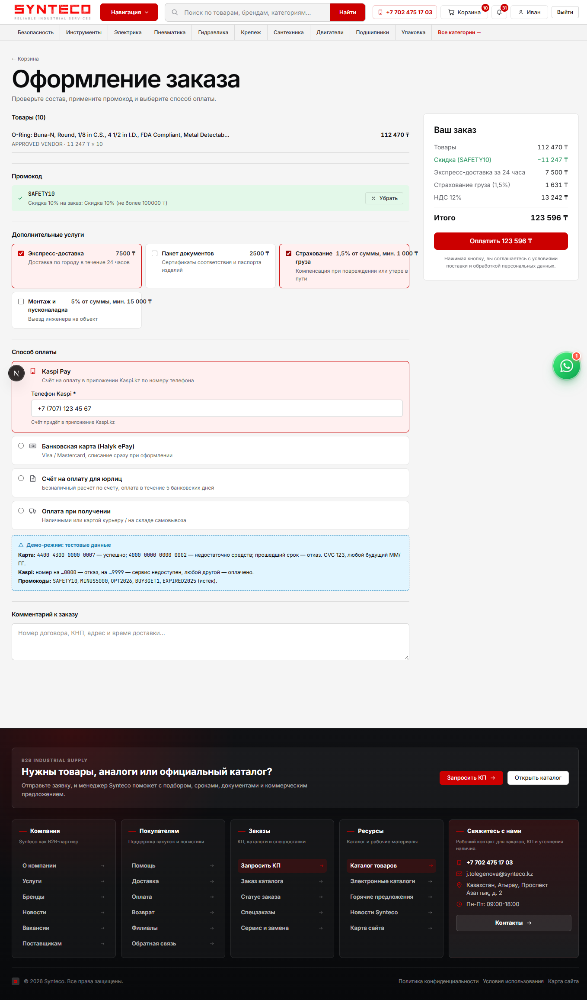

# Synteco Demo — E-Commerce Management System

Course project · **Design patterns: Strategy, Adapter, Decorator** · Option A (E-Commerce)
**Author:** Sauytbek Beksultan (220103118) — individual project

Synteco Demo is a working online store for industrial supplies and personal protective equipment. It is built on a copy of the real [synteco.kz](https://synteco.kz) code base: same design, same catalogue structure, same NestJS + Next.js architecture. The production system is not modified. This repository adds the missing e-commerce workflows:

- live checkout with **promo codes** (Strategy), **optional services** (Decorator) and VAT;
- **simulated payments** through Kaspi Pay and Halyk ePay SDKs that are incompatible with our interface (Adapter);
- order status management, cancellation with refund, **notifications** (email / SMS / WebSocket / in-app, Decorator);
- admin pages for promotions and orders.



## Quick start

Requirements: **Node.js ≥ 20**, **pnpm 9**, **Docker** with Compose v2.

```bash
git clone https://github.com/BekaKOKE/SyntecoDemo.git
cd SyntecoDemo
pnpm install
pnpm demo:setup      # .env, PostgreSQL/Redis/Typesense in Docker, migrations, catalogue, demo data
pnpm dev             # API :3000 · storefront :3001 · admin :3002
```

| App | URL | Login |
|---|---|---|
| Storefront | http://localhost:3001 | `customer@synteco.kz` / `Customer123!` |
| Admin panel | http://localhost:3002 | `admin@synteco.kz` / `Admin123!` (or `manager@synteco.kz` / `Manager123!`) |
| API + Swagger | http://localhost:3000/api-docs | — |

**Test data:** promo codes `SAFETY10`, `MINUS5000`, `OPT2026`, `BUY3GET1`, `EXPIRED2025`.

- Paid by card: `4400 4300 0000 0007` (any future MM/YY, CVC 123).
- Declined card: `4000 0000 0000 0002`.
- Kaspi: any `+7 7XX…` number is paid; a number ending in `0000` is declined.

Details are in the [user guide](docs/05-user-guide.md).

## Tests

```bash
pnpm --filter @synteco/api test        # 262 unit tests — no database needed
pnpm --filter @synteco/api test:e2e    # 64 API end-to-end tests — needs `pnpm demo:setup`
```

Latest run: **326 / 326 passed** ([results](docs/test-results/)).

## Design patterns in the code

| Pattern | Problem solved | Interface | Concrete classes | Client |
|---|---|---|---|---|
| **Strategy** | Interchangeable discount algorithms, chosen at runtime by promo code and switchable by the admin | [`DiscountStrategy`](apps/api/src/modules/promotions/strategies/discount-strategy.interface.ts) | `PercentageDiscountStrategy`, `FixedAmountDiscountStrategy`, `VolumeTierDiscountStrategy`, `BuyXGetYFreeStrategy` | [`PromotionsService`](apps/api/src/modules/promotions/promotions.service.ts) via `DiscountStrategyRegistry` |
| **Adapter** | Third-party payment SDKs with incompatible APIs (tiyn vs tenge, callbacks vs promises, ISO codes) | [`PaymentGateway`](apps/api/src/modules/payments/payment-gateway.interface.ts) | [`KaspiPayAdapter`](apps/api/src/modules/payments/adapters/kaspi-pay.adapter.ts) → `KaspiPayClient`, [`HalykCardAdapter`](apps/api/src/modules/payments/adapters/halyk-card.adapter.ts) → `HalykEpayGateway` (vendor SDKs in [`vendors/`](apps/api/src/modules/payments/vendors), unmodified) | [`PaymentsService`](apps/api/src/modules/payments/payments.service.ts) |
| **Decorator** | Optional, combinable order services without a subclass per combination | [`OrderCost`](apps/api/src/modules/orders/order-cost/order-cost.component.ts) | `ExpressDeliveryDecorator`, `CertificatePackageDecorator`, `CargoInsuranceDecorator`, `InstallationDecorator` | [`OrdersService.calculate`](apps/api/src/modules/orders/orders.service.ts) via `buildOrderCost` |
| **Decorator** (2nd use) | Stackable notification channels | [`Notifier`](apps/api/src/modules/notifications/notifiers.ts) | `EmailNotifier`, `SmsNotifier`, `RealtimeNotifier` around `InAppNotifier` | [`NotificationsService`](apps/api/src/modules/notifications/notifications.service.ts) |

A full explanation with UML is in [docs/02-software-design.md](docs/02-software-design.md).

## Architecture

```
apps/web     Next.js 16 storefront ─┐                       ┌─ PostgreSQL 16 (Prisma, 5 domain schemas)
apps/admin   Next.js admin panel  ──┼─ REST /api/v1 ─ apps/api (NestJS) ─┼─ Redis (cache, optional)
packages/*   shared API client/types┘   controllers → services → Prisma  └─ Typesense (search, optional)
```

Layers: **presentation** (web, admin) → **business logic** (NestJS services + pattern classes) → **data access** (PrismaClient) → **PostgreSQL**. Diagrams: [architecture](docs/diagrams/architecture.svg) · [class diagram](docs/diagrams/class-diagram.svg) · [ERD](docs/diagrams/erd.svg) · [use cases](docs/diagrams/use-case.svg) · [checkout sequence](docs/diagrams/checkout-sequence.svg).

## Documentation

| | Document |
|---|---|
| A | [Requirements specification](docs/01-requirements-specification.md): problem, goals, roles, FR/NFR, use cases |
| B | [Software design](docs/02-software-design.md): architecture, UML class diagram, patterns, design decisions |
| C | [Database design](docs/03-database-design.md): ERD, entities, storage and retrieval |
| D | [Testing](docs/04-testing.md): test cases, pattern tests, error handling, results |
| E | [User guide](docs/05-user-guide.md): installation, features, demo data |

## Repository layout

```
├── apps/
│   ├── api/                 NestJS API
│   │   ├── prisma/          schema, migrations, demo-data/catalog.sql, seed-demo.ts
│   │   └── src/modules/     auth, products, cart, orders, promotions*, payments*, notifications*, …
│   ├── web/                 storefront (Next.js)
│   └── admin/               admin panel (Next.js)
├── packages/                shared-api-client, shared-types
├── infra/docker/init-db.sql PostgreSQL extensions + schemas
├── docs/                    documentation A–E, diagrams, screenshots, test results
└── docker-compose.yml       PostgreSQL · Redis · Typesense for the demo
```
`*` = added in this project.

## Notes

- Payments, SMS and (by default) email are **simulated**. No real money or messages are sent.
- The catalogue snapshot contains public product data only. There are no customer records.
- Production deployment scripts and business integrations of the real Synteco system are intentionally not part of this repository.
