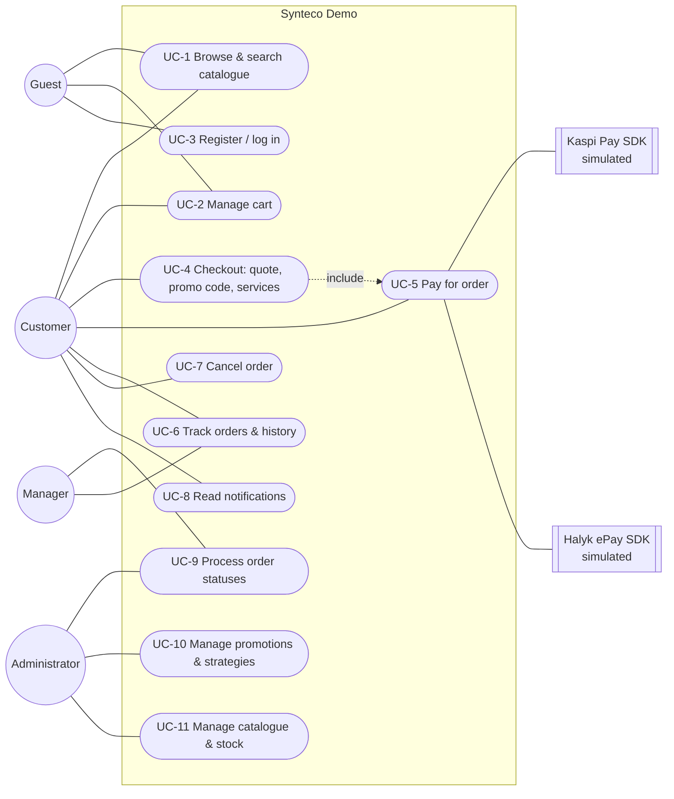

# A. Requirements Specification — Synteco Demo (E-Commerce Management System)

| | |
|---|---|
| **Project option** | A — E-Commerce Management System |
| **Author** | Sauytbek Beksultan, student ID 220103118 (individual project) |
| **Base system** | Copy of the Synteco B2B industrial-supply store (synteco.kz). The production system is not modified; this repository is an independent demo. |
| **Patterns** | Strategy (discounts), Adapter (payment providers), Decorator (order services, notification channels) |

---

## 1. Problem statement

Synteco sells personal protective equipment (PPE) and industrial MRO goods to companies in Kazakhstan. The production site works as a *catalogue + request-for-quote* tool: customers add goods to a cart and a manager calls them back with a price. This leaves out the core e-commerce operations: the customer cannot see the final price, apply a discount, pay, or follow the order on their own.

The goal of this project is to turn the store into a complete e-commerce management system **without touching the production system**. The demo should keep the real site's look, catalogue and architecture and add the missing workflows.

## 2. Project goals

| # | Goal | Measure of success |
|---|------|--------------------|
| G1 | Customers can complete a purchase end-to-end: browse → cart → checkout → pay → track. | Main workflow (UC-1…UC-8) runs in the browser without manual steps. |
| G2 | Prices, discounts, optional services and VAT are calculated transparently. | Checkout shows an itemised breakdown that matches the stored order. |
| G3 | Several payment providers with incompatible APIs work through one interface. | 4 payment methods; adding a provider requires no change in order code. |
| G4 | Administrators manage orders, statuses and promotions. | Status machine + promotions CRUD in the admin panel. |
| G5 | Customers are notified about order events. | Every order event creates a persisted notification + email/SMS/WebSocket delivery. |
| G6 | The code base is maintainable and demonstrates Strategy, Adapter and Decorator. | Patterns isolated in their own modules and covered by tests. |

## 3. Target users and roles

| Role (DB value) | Who | Main permissions |
|---|---|---|
| **Guest** (not logged in) | Visitor | Browse/search catalogue, guest cart, register, log in |
| **Customer** (`customer_buyer`, `customer_admin`, `customer_viewer`) | Employee of a client company | Cart, checkout, promo codes, payment, order history, cancel own order, notifications, profile |
| **Manager** (`manager`) | Synteco sales manager | View all orders, approve orders, move orders through statuses, view promotions |
| **Administrator** (`admin`, `super_admin`) | Store administrator | Everything a manager can do + create/edit/delete promotions, switch discount strategies, manage products, brands, categories, users |

Authorisation is enforced on the server: a global `JwtAuthGuard` plus a `RolesGuard` reading `@Roles(...)`. Ownership is checked in the services, e.g. a customer can only see, pay for or cancel their own orders.

## 4. Functional requirements

Requirement IDs are referenced from the test documentation (docs/04-testing.md).

### 4.1 Catalogue
- **FR-01** The system shall display a product catalogue with categories (tree), brands, descriptions, specifications, prices and stock quantities per warehouse.
- **FR-02** The system shall support full-text product search with autocomplete (Typesense, with a PostgreSQL fallback).
- **FR-03** The system shall support filtering by category, brand, availability and price range, sorting, and pagination.

### 4.2 Cart
- **FR-04** Users (guest via session id, or authenticated) shall add, update and remove cart items. The price is snapshotted when an item is added.
- **FR-05** The system shall reject quantities that are not positive integers and products that do not exist.

### 4.3 Checkout, pricing and promotions
- **FR-06** At checkout the customer shall see a live quote: goods subtotal, discount, selected services, VAT 12% and total.
- **FR-07** The customer may enter a promo code. The promotion's **discount strategy** (percentage, fixed amount, volume tier, buy-X-get-Y) is selected at runtime from the promotion record.
- **FR-08** Invalid promo codes shall be rejected with a reason: not found, inactive, not started, expired, usage limit reached, below minimum order amount.
- **FR-09** The customer may add optional services: express delivery, certificate package, cargo insurance, on-site installation. Services can be combined, and each adds its own charge to the order cost (**decorators**).
- **FR-10** Creating an order shall validate the cart (not empty) and stock (enough available units), reserve stock across warehouses, generate an order number `SO-YYYY-NNNNNN`, store the price breakdown, count the promo usage and clear the cart, all in one database transaction.

### 4.4 Payment (simulated)
- **FR-11** The system shall support multiple payment methods: Kaspi Pay (phone), bank card via Halyk ePay, bank invoice for companies, cash on delivery. External providers are simulated SDKs accessed through **adapters**.
- **FR-12** A successful online payment shall mark the order `paid` and automatically confirm a `pending` order. A declined payment shall keep the order and allow the customer to retry with any method.
- **FR-13** Paying for an already-paid or cancelled order shall be rejected. Malformed payment details (phone, card number, expiry, CVC) shall be rejected before the order is created.
- **FR-14** Each payment attempt shall be stored with method, status, amount, external transaction id and message.

### 4.5 Orders and status management
- **FR-15** Customers shall see their order history with items, totals, services, promo, payment status, payment attempts and status history.
- **FR-16** Staff shall move orders through the state machine `pending → confirmed → processing → picking → packed → shipped → delivered`. Cancellation is allowed from any state before `shipped`. Invalid transitions shall be rejected.
- **FR-17** Shipping an order shall deduct stock. Cancelling shall release reserved stock and mark a paid order as `refunded`.
- **FR-18** Customers may cancel only their own orders, and only in `pending` or `confirmed` status.

### 4.6 Notifications
- **FR-19** The system shall notify the customer on order creation, payment success/failure and every status change.
- **FR-20** Each notification shall be stored (in-app inbox) and delivered through the available channels: email, SMS, real-time WebSocket. Channels are **decorators** around the in-app notifier.
- **FR-21** Customers shall list notifications, see the unread count, and mark one or all as read.

### 4.7 Administration
- **FR-22** Administrators shall create, edit, activate/deactivate and delete promotions, including **switching a promotion to another discount strategy at runtime**.
- **FR-23** Staff shall view all orders with filtering by status, and change statuses from the admin panel.
- **FR-24** Administrators shall manage products, categories, brands and stock (existing Synteco functionality).

### 4.8 Accounts
- **FR-25** Users shall register (with explicit personal-data consent, required by Kazakhstan Law No. 94-V), log in, refresh and revoke tokens, and edit their profile.

## 5. Non-functional requirements

| ID | Category | Requirement |
|---|---|---|
| NFR-01 | Persistence | All business data is stored in PostgreSQL 16 via Prisma ORM; schema is versioned by migrations. In-memory storage is used only for caching. |
| NFR-02 | Reliability | Order creation and payment recording are atomic (DB transactions). A notification failure never breaks an order. |
| NFR-03 | Security | JWT access + rotating refresh tokens, bcrypt password hashes, role guards, CSRF for public forms, Helmet CSP, rate limiting, input sanitisation. No card data is stored: only the outcome of a payment. |
| NFR-04 | Validation | Every request body is validated by `class-validator` DTOs (whitelist mode). Errors use the RFC 7807 Problem Details format with a machine-readable `errorCode` and a human-readable `detail`. |
| NFR-05 | Maintainability | Modular monolith: one NestJS module per domain. Patterns are isolated behind interfaces. TypeScript strict mode. |
| NFR-06 | Extensibility | A new discount strategy, payment provider, order service or notification channel is added by writing one class and registering it, with no changes to client code (verified by tests). |
| NFR-07 | Testability | ≥ 5 main-functionality tests plus pattern tests. Unit tests run without a database (`pnpm test`); E2E tests run against the demo DB (`pnpm test:e2e`). |
| NFR-08 | Portability | Infrastructure starts with one `docker compose up -d`; the app runs on Windows, macOS and Linux with Node ≥ 20 and pnpm 9. |
| NFR-09 | Performance | Catalogue pages and checkout respond in under 1 s on the demo data set; order lists batch-load products and customers (no N+1 queries). |
| NFR-10 | Usability | Russian UI consistent with synteco.kz; validation messages are shown next to the field/action; responsive layout. |
| NFR-11 | Isolation | The demo uses its own compose project, ports, volumes and Git repository. Email is simulated unless SMTP is configured. |

## 6. Use cases

### 6.1 Use-case diagram

An image version is in `docs/diagrams/use-case.svg`.

### 6.2 Use-case descriptions

**UC-4 Checkout (main success scenario)**

| | |
|---|---|
| Actor | Customer |
| Pre-conditions | Customer is logged in; cart has ≥ 1 item |
| Trigger | Customer clicks “Оформить заказ” in the cart |
| Main flow | 1. System shows cart items and a quote (`POST /orders/quote`). 2. Customer enters promo code `SAFETY10` → system validates it and shows the discount from the selected strategy. 3. Customer ticks “Экспресс-доставка” and “Страхование груза” → quote is recalculated. 4. Customer selects a payment method and fills in its details. 5. Customer confirms → system creates the order (`POST /orders`), reserves stock, clears the cart, charges the payment (UC-5) and sends notifications (UC-8). 6. System shows the order number and the payment result. |
| Alternative flows | 2a. Code is invalid or expired → reason shown, order total unchanged. 5a. Not enough stock → order not created, items listed. 5b. Malformed card or phone → error shown, nothing created. 5c. Payment declined → order created with payment status *failed*; customer can retry (UC-5). |
| Post-conditions | Order stored with breakdown; stock reserved; promo usage +1; notification(s) stored |

**UC-5 Pay for order**

| | |
|---|---|
| Actor | Customer; external payment provider |
| Pre-conditions | Order exists, not cancelled, not paid |
| Main flow | 1. Customer chooses a method (Kaspi / card / invoice / cash). 2. System passes the request to the matching `PaymentGateway` adapter. 3. The adapter calls the provider SDK in the SDK's own format and maps the answer back. 4. System stores a `Payment` row; if paid, the order becomes `paid` + `confirmed`. 5. Customer is notified. |
| Alternative flows | 3a. Declined (insufficient funds / invalid card / expired) → payment `failed`, reason shown. 3b. Provider unavailable → payment `failed`, retry later. 1a. Order already paid → HTTP 409. |

**UC-7 Cancel order** — Customer (own order, status pending/confirmed) or staff (any state allowed by the state machine) cancels with a reason. Stock reservations are released, a paid order becomes `refunded` with a refund payment record, and the customer is notified. A customer trying to cancel a shipped order gets `ORDER_CANNOT_CANCEL`.

**UC-9 Process order statuses** — Manager opens an order in the admin panel, sees the allowed next statuses (`GET /orders/:id/transitions`) and applies one. Invalid jumps (e.g. pending → shipped) are rejected. `shipped` deducts stock. Each change is written to the status history and notified.

**UC-10 Manage promotions** — Administrator creates a promo code, selects a strategy from the list of registered strategies, and fills in the strategy-specific parameters (percent/cap, amount, tiers, buy/free). The configuration is validated by the strategy itself. Changing the strategy of an existing promotion changes the algorithm used for the next quote immediately.

**UC-1 Browse & search** — Guest/customer browses categories and brands, uses search with autocomplete, filters and sorts results, and opens a product page with specifications, stock and price.

**UC-2 Manage cart** — Add/update/remove items, as a guest (session id) or as a logged-in user. Quantity must be ≥ 1.

**UC-6 Track orders** — Customer opens “Мои заказы” and sees status, payment status, breakdown, payments and status timeline. Staff see all orders.

**UC-8 Notifications** — Customer opens “Уведомления”, sees unread items and the channels used, and marks them read.

## 7. Constraints and assumptions

- Payments are **simulated**: no real money is moved. Test phones/cards trigger approval or specific declines (see README).
- Email is logged instead of sent unless SMTP variables are provided. SMS is always simulated.
- Prices are in tenge (KZT), VAT is 12% (Kazakhstan), rounded per goods line to match 1C/e-invoice rounding.
- The demo catalogue is a snapshot of the public product catalogue (881 products). It contains no customer data.
