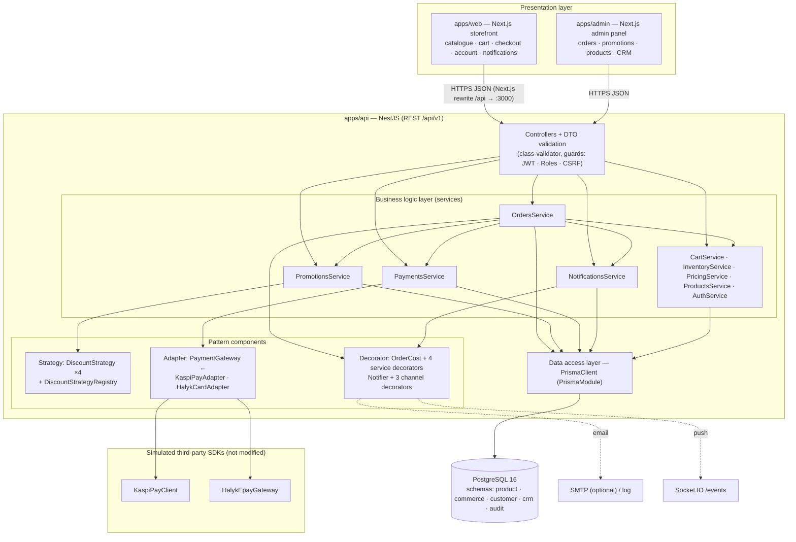
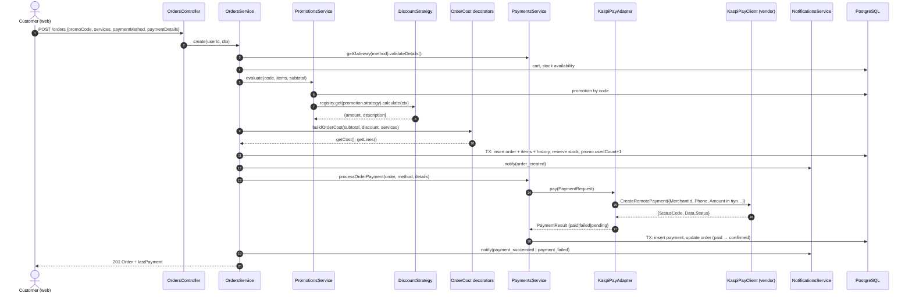
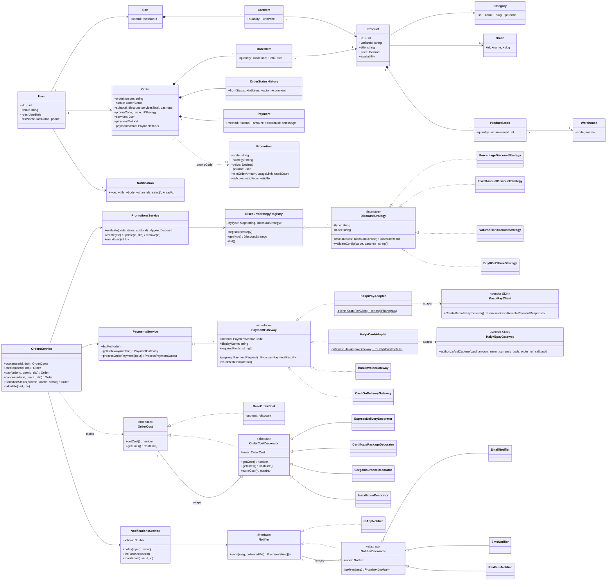

# B. Software Design — Synteco Demo

## 1. Architecture overview

Synteco is a **TypeScript monorepo** (pnpm workspaces + Turborepo) with three applications and two shared packages:

| Part | Technology | Role |
|---|---|---|
| `apps/web` | Next.js 16 (React 19, App Router) | Customer storefront, port 3001 (**presentation layer**) |
| `apps/admin` | Next.js | Admin / manager panel, port 3002 (**presentation layer**) |
| `apps/api` | NestJS 10, Prisma 5 | REST API `/api/v1`, Swagger at `/api-docs`, port 3000 (**business logic + data access**) |
| `packages/shared-api-client` | TypeScript | Fetch client with token refresh, used by both front-ends |
| `packages/shared-types` | TypeScript | Shared DTO types |
| PostgreSQL 16 | Docker | Persistent storage (**data layer**) |
| Redis / Typesense | Docker, optional | Cache / autocomplete. The API falls back to in-memory cache and PostgreSQL search if they are unavailable. |

### 1.1 Layered architecture



Image version: `docs/diagrams/architecture.svg`.

**Separation of concerns**

- **Controllers** only map HTTP to service calls. They declare roles (`@Roles`), public endpoints (`@Public`) and DTOs. They contain no business rules.
- **Services** hold all business rules: stock checks, the state machine, ownership checks, transactions, promotion validity.
- **Pattern components** are plain TypeScript classes behind interfaces. They do not know about HTTP or the database, which makes them unit-testable in isolation.
- **Data access** goes only through `PrismaClient`, provided once by the global `PrismaModule`. Services receive it through dependency injection, so tests replace it with a mock.
- **Errors**: services throw `AppException(ErrorCode, detail)`. A global `AllExceptionsFilter` turns these into RFC 7807 Problem Details with an HTTP status taken from `ErrorCodeStatus`.

### 1.2 Request flow — checkout



## 2. UML class diagram

The diagram shows the domain model and the classes added for the three patterns. Infrastructure classes of the original system (auth, CRM, inquiries, search) are omitted for readability.



Image version: `docs/diagrams/class-diagram.svg`.

## 3. Design patterns

### 3.1 Strategy — discount algorithms

**Problem.** Marketing needs different discount rules: a percentage, a fixed amount, B2B volume tiers, buy-X-get-Y. More will come later. A `switch (promotion.type)` inside the order code would grow with every rule and would have to be retested each time.

**Solution.** Each rule is a separate class implementing the common interface `DiscountStrategy` (`apps/api/src/modules/promotions/strategies/discount-strategy.interface.ts`):

| Concrete strategy | `type` | Parameters | Example |
|---|---|---|---|
| `PercentageDiscountStrategy` | `percentage` | `value` = %, `params.maxDiscount` | `SAFETY10`: 10%, at most 100 000 ₸ |
| `FixedAmountDiscountStrategy` | `fixed_amount` | `value` = ₸ | `MINUS5000`: −5 000 ₸ for orders from 30 000 ₸ |
| `VolumeTierDiscountStrategy` | `volume_tier` | `params.tiers[{minQuantity, percent}]` | `OPT2026`: −3/7/12% per line from 10/50/100 pcs |
| `BuyXGetYFreeStrategy` | `buy_x_get_y` | `params.buy`, `params.free` | `BUY3GET1`: every 4th unit free |

- **Context / client:** `PromotionsService.evaluate()` loads the promotion by code, asks `DiscountStrategyRegistry.get(promotion.strategy)` for the strategy, and calls `calculate()`. It never checks which concrete class it received.
- **Runtime selection:** the strategy is chosen per request from data, namely the promo code the customer types. An administrator can **switch** a promotion to another strategy (`PATCH /promotions/:id {strategy}`), and the next quote uses the new algorithm with no redeploy.
- **Open/closed:** strategies are registered through the `DISCOUNT_STRATEGIES` multi-provider in `PromotionsModule` (`STRATEGY_CLASSES` array). To add an algorithm, write a class and add it to that array. `PromotionsService`, `OrdersService` and the UI (which reads `GET /promotions/strategies`) stay unchanged. Two tests prove this by registering strategies that did not exist when the code was written: `per_line` in `discount-strategies.spec.ts` and `seasonal_double` in `promotions.service.spec.ts`.
- Each strategy also validates its own configuration (`validateConfig`), so the admin form gets strategy-specific error messages without a central switch.

### 3.2 Adapter — payment providers

**Problem.** The application needs one simple contract: “charge this order and tell me paid / pending / failed”. Real providers have incompatible APIs. We cannot change their SDKs.

**Target interface:** `PaymentGateway` (`apps/api/src/modules/payments/payment-gateway.interface.ts`) with `pay(PaymentRequest): Promise<PaymentResult>`, amounts in tenge.

**Adaptees** are simulated third-party SDKs in `apps/api/src/modules/payments/vendors/`. They are marked *DO NOT MODIFY* and are never edited to fit Synteco:

| SDK | Incompatibility |
|---|---|
| `KaspiPayClient` | PascalCase fields; amount as integer **tiyn**; 10-digit phone without `+7`; result is `StatusCode` + nested `Data.Status = Approved/Rejected` |
| `HalykEpayGateway` | **Node-style callback** instead of a Promise; snake_case; amount as a **string in minor units**; ISO-4217 numeric currency `398`; ISO-8583 response codes `00/14/51/54` |

**Adapters:**

- `KaspiPayAdapter` normalises the phone (`+7 (701) 123-45-67` → `7011234567`), converts ₸ → tiyn, calls `CreateRemotePayment`, and maps `Approved` → `paid` and `Rejected/InsufficientFunds` or `503` → `failed` with a Russian reason.
- `HalykCardAdapter` validates and maps card fields (`MM/YY` → `exp_month/exp_year`), converts the amount to a minor-unit string, wraps the callback API in a `Promise`, and maps response codes to `PaymentResult`.

`BankInvoiceGateway` and `CashOnDeliveryGateway` are our own code, so they implement `PaymentGateway` directly and need no adapter.

`PaymentsService` holds all gateways (`PAYMENT_GATEWAYS` multi-provider) in a map keyed by `method`. It works only with the target interface: it records the `Payment`, updates the order, and auto-confirms a pending order on success. A test runs all four gateways polymorphically through `PaymentGateway`.

### 3.3 Decorator — optional services and notification channels

**(a) Order cost.** The customer can add any combination of optional services to an order: express delivery (+7 500 ₸), certificate package (+2 500 ₸), cargo insurance (+1.5%, min 1 000 ₸), on-site installation (+5%, min 15 000 ₸). Writing a subclass for every combination would mean 2⁴ = 16 classes.

- **Component interface:** `OrderCost { getCost(); getLines() }` in `apps/api/src/modules/orders/order-cost/order-cost.component.ts`.
- **Concrete component:** `BaseOrderCost`, goods subtotal minus the promo discount.
- **Base decorator:** `OrderCostDecorator` implements `OrderCost`, holds `inner: OrderCost`, and returns `inner.getCost() + extraCost()` and `[...inner.getLines(), ownLine]`.
- **Concrete decorators (4):** `ExpressDeliveryDecorator`, `CertificatePackageDecorator`, `CargoInsuranceDecorator`, `InstallationDecorator`. Percentage-based decorators compute their fee from the *wrapped* cost.
- **Composition at runtime:** `buildOrderCost(subtotal, discount, serviceCodes)` wraps the base once per selected service, in a fixed order (flat fees first) so totals are deterministic. Duplicates are ignored and unknown codes are rejected. Example: `new CargoInsuranceDecorator(new ExpressDeliveryDecorator(new BaseOrderCost(100000, 10000)))`.
- `BaseOrderCost` was never changed to support services. A test adds a new `GiftWrapDecorator` on top of the existing ones without touching any of them.

**(b) Notification channels.** `Notifier.send()` has the concrete component `InAppNotifier`, which persists the notification. The decorators `RealtimeNotifier` (Socket.IO), `EmailNotifier` (MailerService) and `SmsNotifier` (simulated) each deliver through their channel and then delegate to the wrapped notifier, passing on the list of channels used. `NotificationsService` composes the chain once: `new SmsNotifier(new EmailNotifier(new RealtimeNotifier(new InAppNotifier(prisma), events), mailer))`. A channel without an address (e.g. no phone) is skipped while the others still run.

## 4. Important design decisions

| Decision | Reason |
|---|---|
| Keep the existing modular-monolith NestJS architecture and add 3 new modules (`promotions`, `payments`, `notifications`) | Consistency with the real system; each module owns its controller, service, DTOs and pattern classes |
| Strategy type stored as a string in `promotions.strategy`, not as a DB enum | New strategies need no migration; the registry validates the type |
| Multi-providers (`DISCOUNT_STRATEGIES`, `PAYMENT_GATEWAYS`) instead of `new` in services | Dependency injection keeps services unaware of concrete classes; tests inject fakes |
| Decorators built per request with plain `new`, not through DI | They are short-lived value objects wrapping per-order data |
| Payment errors after an order is created are stored as a *failed* attempt, not as an HTTP error | The order and stock reservation already exist; the customer retries with `POST /orders/:id/pay`. Malformed details are rejected **before** creating the order (`validateDetails`) |
| Successful online payment auto-confirms a `pending` order | The money is captured, so no manual approval is needed; invoice/cash orders still wait for a manager |
| Price breakdown denormalised into `orders` (`discount`, `servicesTotal`, `services` JSON, `promoCode`, `discountStrategy`) | Order history must not change when promotions or service prices change later |
| VAT rounded per goods line, plus one adjustment line for services and discount | Matches Kazakhstan e-invoice / 1C rounding used by the real business |
| Cancellation of a paid order creates a `refunded` payment row | An auditable money trail (simulated refund) |
| Notifications never throw | A broken SMTP server must not roll back an order |
| Ownership checks in services (not only role guards) | A customer may hold a valid token yet try another customer's order id |

## 5. Package / folder map (new code)

```
apps/api/src/modules/
├── promotions/                      Strategy
│   ├── strategies/                  interface, 4 strategies, registry (+ spec)
│   ├── dto/promotion.dto.ts
│   ├── promotions.service.ts        context/client of the strategies (+ spec)
│   ├── promotions.controller.ts     /promotions (validate, admin CRUD, strategies)
│   └── promotions.module.ts         STRATEGY_CLASSES registration
├── payments/                        Adapter
│   ├── payment-gateway.interface.ts target
│   ├── vendors/                     simulated SDKs (adaptees, not modified)
│   ├── adapters/                    KaspiPayAdapter, HalykCardAdapter (+ spec)
│   ├── gateways/offline.gateways.ts native gateways
│   ├── payments.service.ts          (+ spec)
│   └── payments.controller.ts       GET /payments/methods
├── notifications/                   Decorator (channels)
│   ├── notifiers.ts                 InAppNotifier + 3 decorators (+ spec)
│   ├── notifications.service.ts
│   └── notifications.controller.ts  /notifications
└── orders/
    ├── order-cost/                  Decorator (services) (+ spec)
    ├── orders.service.ts            quote / create / pay / cancel / transitions (+ spec)
    └── checkout-patterns.e2e.spec.ts
```
