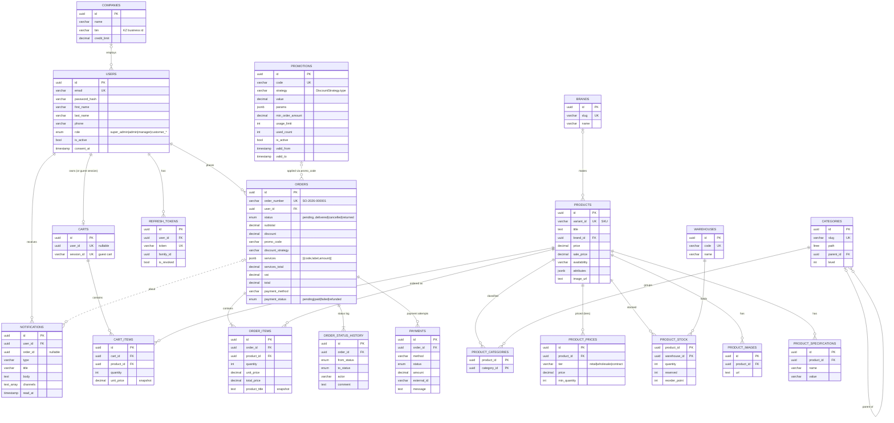

# C. Database Design — Synteco Demo

**DBMS:** PostgreSQL 16 (Docker image `pgvector/pgvector:pg16`) · **ORM:** Prisma 5 · **Schema source:** `apps/api/prisma/schema.prisma` · **Migrations:** `apps/api/prisma/migrations/0_initial … 5_promotions_payments_notifications`

The database is split into PostgreSQL **schemas per domain**, the same way the production system is split:

| Schema | Tables |
|---|---|
| `product` | brands, categories, category_closure, products, product_categories, product_variants, product_images, product_documents, product_prices, product_specifications, warehouses, product_stock |
| `commerce` | carts, cart_items, orders, order_items, order_status_history, **promotions**, **payments** |
| `customer` | users, refresh_tokens, companies, **notifications** |
| `crm` | inquiries, deals (B2B lead management, existing) |
| `import_export`, `audit` | import_jobs, audit_logs |

Bold = added in this project (migration `5_promotions_payments_notifications`).

## 1. Entity-relationship diagram (e-commerce core)



Image version: `docs/diagrams/erd.svg`.

## 2. Main entities and relationships

| Entity | Purpose | Key relationships / rules |
|---|---|---|
| **User** | Account of a customer or staff member; `role` drives authorisation | 1 — 0..1 Cart; 1 — * Order; 1 — * Notification; e-mail unique; password stored as bcrypt hash; consent timestamp stored by law |
| **Product** | Catalogue item (SKU = `variant_id`) with description, attributes (JSONB), images | * — 0..1 Brand; * — * Category via `product_categories`; 1 — * ProductPrice (tiers); 1 — * ProductStock |
| **Category** | Hierarchical catalogue tree | Self-reference `parent_id`; `path` is a PostgreSQL `ltree` for subtree queries |
| **Warehouse / ProductStock** | Stock per product per warehouse (Almaty, Astana, Shymkent, Atyrau) | Composite PK (product, warehouse). `available = quantity − reserved`. Orders reserve; shipping deducts; cancelling releases |
| **Cart / CartItem** | Server-side cart for a user or guest session | Unit price snapshotted at add time; unique (cart, product) |
| **Order** | Placed order with its full price breakdown and payment state | 1 — * OrderItem (product title/SKU snapshot), 1 — * OrderStatusHistory, 1 — * Payment. `promo_code` + `discount_strategy` record which Strategy was applied; `services` JSON records which Decorators were applied |
| **OrderStatusHistory** | Audit trail of the order state machine | One row per transition with actor (user id or `system`) and comment |
| **Payment** | One attempt through a PaymentGateway (Adapter) | * — 1 Order (cascade delete). Status `paid / pending / failed / refunded`; `external_id` = provider transaction id. **No card data is stored.** |
| **Promotion** | Promo code bound to a discount strategy | `strategy` holds the `DiscountStrategy.type`; `value` + `params` are interpreted by that strategy; validity window, usage limit and min amount are checked by `PromotionsService` |
| **Notification** | In-app message (component of the notifier decorator chain) | * — 1 User; optional link to an order; `channels` lists every channel the message went through (`sms`, `email`, `websocket`, `in_app`) |

**Integrity rules enforced in the database**

- Primary keys are UUIDs (`gen_random_uuid()` / Prisma `uuid()`).
- Unique keys: `users.email`, `orders.order_number`, `products.variant_id`, `promotions.code`, `(product_id, warehouse_id)` in stock, `(product_id, tier, min_quantity)` in prices.
- Foreign keys: order_items → orders/products, cart_items → carts/products (migration 3), payments → orders (`ON DELETE CASCADE`).
- Money is `DECIMAL(14,2)` (never floating point). Enumerations (`OrderStatus`, `PaymentStatus`, `UserRole`) are PostgreSQL enums.
- Indexes support the main queries: `orders(user_id, created_at)`, `orders(status)`, `payments(order_id)`, `notifications(user_id, created_at)`, `promotions(is_active)`, GIN index on `products.attributes` (JSONB filters), `products(quality_score)` for ranking.

## 3. How data is stored and retrieved

**Data access layer.** All database access goes through one `PrismaClient`. The global `PrismaModule` provides it, and services receive it by constructor injection. Prisma generates type-safe query methods from `schema.prisma`, so a wrong field name is a compile error.

**Writes that must be atomic** use interactive transactions (`prisma.$transaction(async tx => …)`):

| Operation | Statements in one transaction |
|---|---|
| Create order (`OrdersService.create`) | insert `orders` → insert `order_items` (one `createMany`) → insert `order_status_history` → `promotions.used_count + 1` → reserve stock per item across warehouses (`product_stock.reserved += qty`) |
| Record payment (`PaymentsService.processOrderPayment`) | insert `payments` → update `orders.payment_status / payment_method` (+ `status = confirmed` and a history row when paid) |
| Cancel order | update order status (+ `payment_status = refunded`) → history row → refund `payments` row → release reserved stock |
| Ship order | status update → history → release reservation and deduct `product_stock.quantity` |

**Reads**

- Order history: `orders` with `include: { items, statusHistory, payments }`. Product details and customers for a page of orders are fetched in **two batched queries** (`WHERE id IN (…)`), avoiding N+1 queries.
- Catalogue: paginated `products` with filters (category subtree, brand, availability, price range) and full-text search. Facet counts use aggregate queries. Autocomplete uses Typesense when available, otherwise a case-insensitive PostgreSQL `ILIKE` search.
- Stock availability for a cart: one `product_stock` query grouped per product (`InventoryService.getBulkAvailability`).
- Notifications: latest 30 by `(user_id, created_at DESC)` plus an unread `COUNT(*) WHERE read_at IS NULL`.

**Caching.** Read-heavy reference data (categories, brands, admin stats) is cached through Nest `CacheModule`, backed by Redis or by an in-memory fallback. The cache is never the source of truth.

## 4. Schema creation and initial data

```bash
docker compose up -d                       # PostgreSQL 16 on localhost:5434 (+ init-db.sql: extensions & schemas)
cd apps/api && cp .env.example .env
pnpm db:demo                               # = prisma migrate deploy
                                           #   + prisma db execute --file prisma/demo-data/catalog.sql
                                           #   + tsx prisma/seed-demo.ts
```

| File | Content |
|---|---|
| `infra/docker/init-db.sql` | Extensions (`uuid-ossp`, `pgcrypto`, `ltree`, `pg_trgm`, `btree_gin`, `vector`) and domain schemas, run once by the Postgres container |
| `apps/api/prisma/migrations/*` | DDL for all tables (versioned) |
| `apps/api/prisma/demo-data/catalog.sql` | Public catalogue snapshot: 4 warehouses, 386 brands, 114 categories, 881 products, 879 prices, 880 stock rows (INSERT statements, no customer data) |
| `apps/api/prisma/seed-demo.ts` | Demo accounts (admin, manager, customer), 5 promo codes (one per strategy + an expired one), retail price and ≥ 200 units of stock for every product |

Reset everything: `docker compose down -v && docker compose up -d && pnpm --filter @synteco/api db:demo`.
