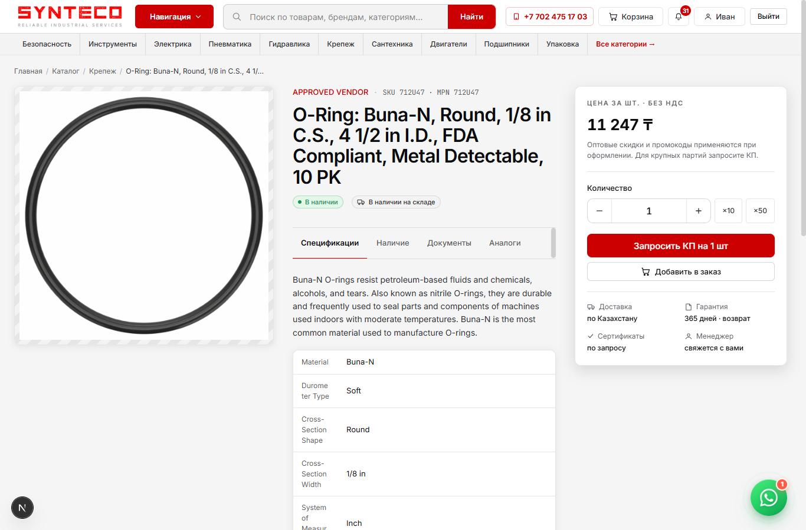
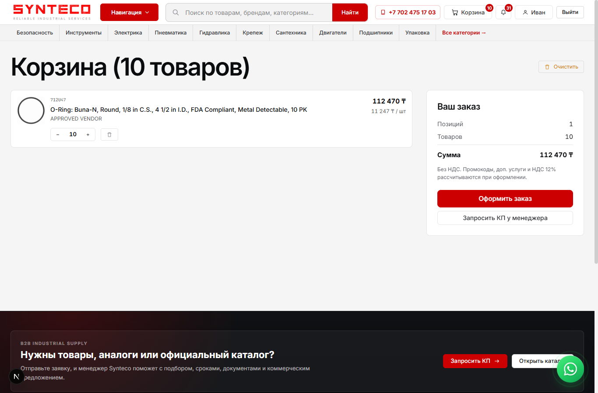
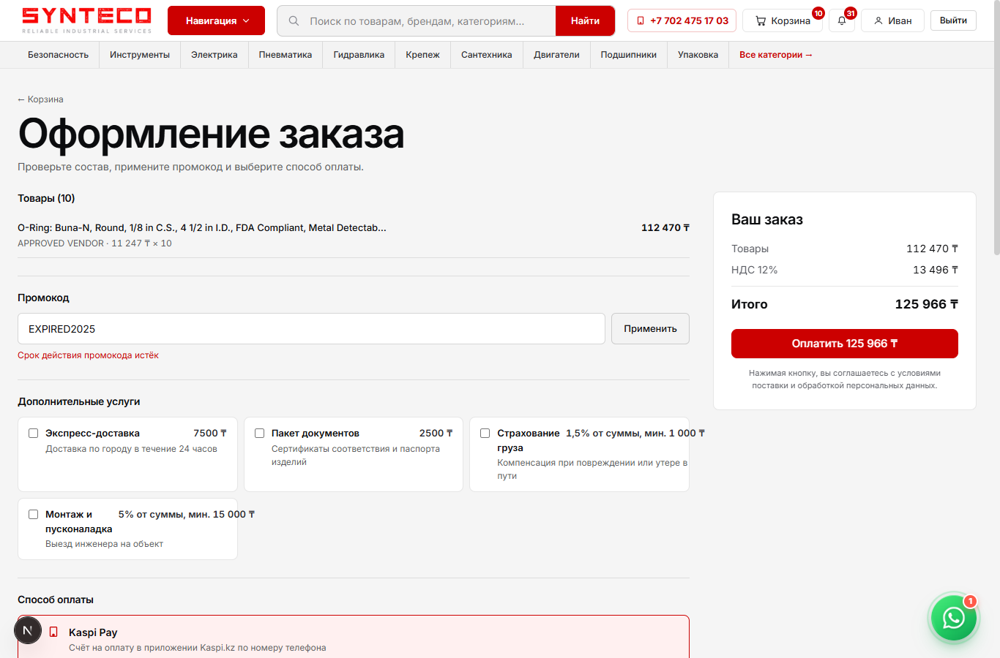
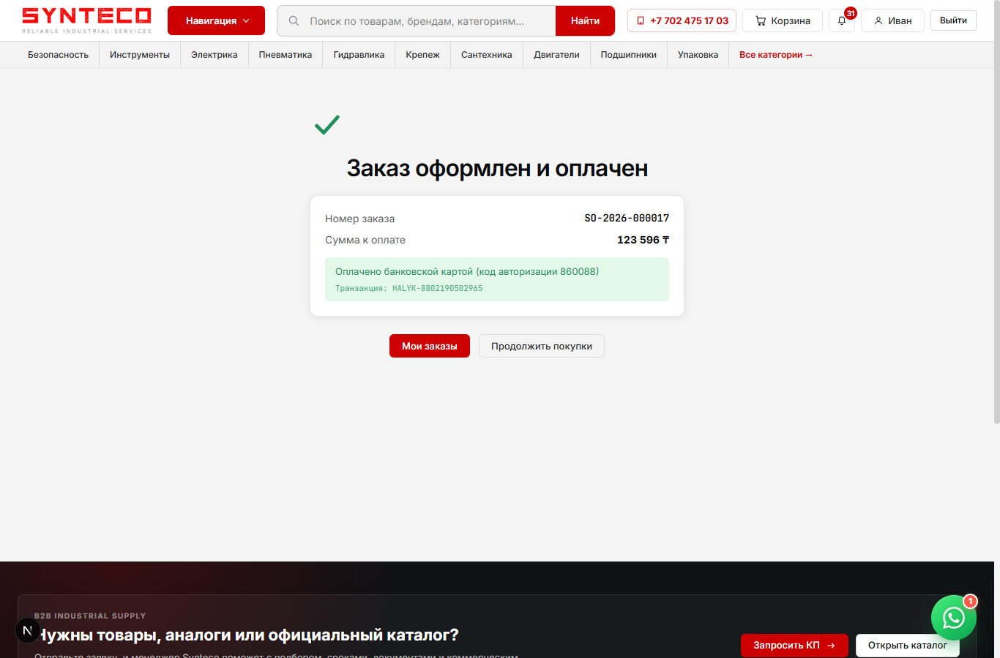
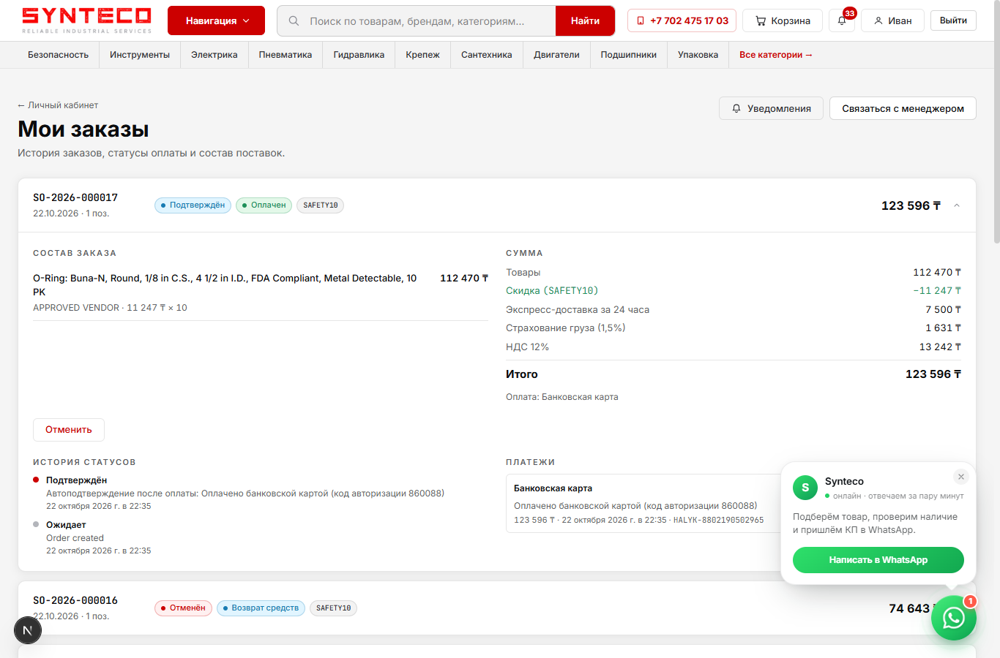
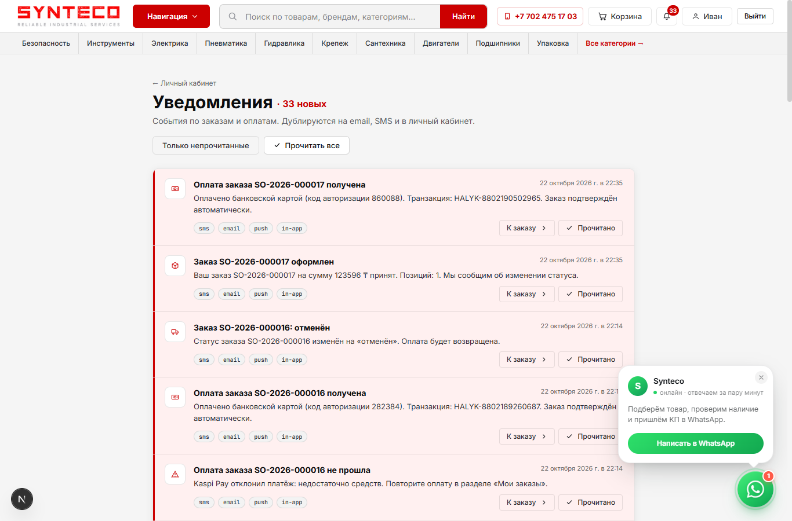
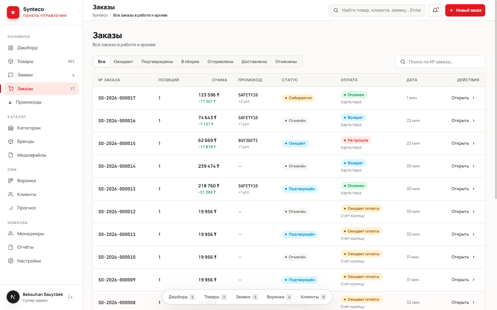
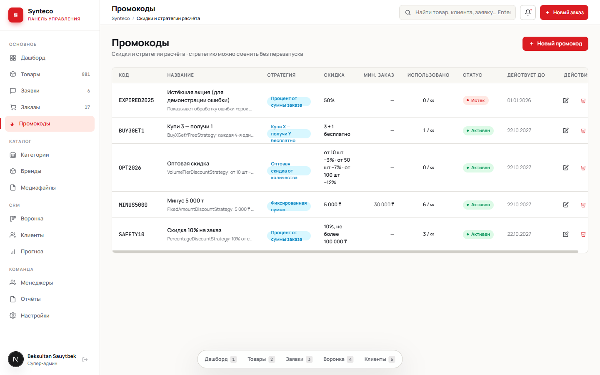
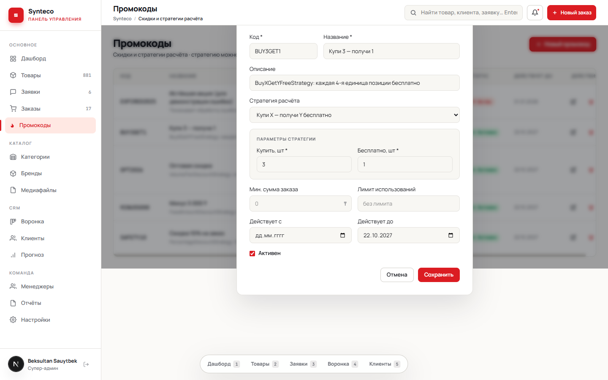

# E. User Documentation — Synteco Demo

## 1. Installation

### 1.1 Requirements

| Software | Version | Check |
|---|---|---|
| Node.js | 20 or newer (tested with 24) | `node -v` |
| pnpm | 9.x | `pnpm -v` (install: `npm i -g pnpm@9` or `corepack enable`) |
| Docker Desktop / Docker Engine with Compose v2 | any recent | `docker compose version` |
| Free ports | 3000 (API), 3001 (shop), 3002 (admin), 5434 (PostgreSQL), 6381 (Redis), 8109 (Typesense) | |

### 1.2 First start (about 5 minutes)

```bash
git clone https://github.com/BekaKOKE/SyntecoDemo.git
cd SyntecoDemo
pnpm install            # installs all workspaces
pnpm demo:setup         # .env + docker compose up --wait + migrations + catalogue + demo data
pnpm dev                # starts API :3000, storefront :3001, admin :3002
```

`pnpm demo:setup` performs these steps:

1. Copies `apps/api/.env.example` → `apps/api/.env`. The defaults match `docker-compose.yml`, so no editing is needed.
2. Starts PostgreSQL 16, Redis and Typesense in Docker (compose project `synteco-demo`) and waits until they are healthy.
3. Runs `prisma migrate deploy`, loads `apps/api/prisma/demo-data/catalog.sql`, and runs `prisma/seed-demo.ts`.

If you prefer three terminals instead of `pnpm dev`:

```bash
pnpm dev:api      # http://localhost:3000  (Swagger: http://localhost:3000/api-docs)
pnpm dev:web      # http://localhost:3001  storefront
pnpm dev:admin    # http://localhost:3002  admin panel
```

### 1.3 Useful commands

| Command | Purpose |
|---|---|
| `pnpm --filter @synteco/api test` | Unit tests (no database needed) |
| `pnpm --filter @synteco/api test:e2e` | API end-to-end tests (needs `demo:setup`) |
| `pnpm demo:reset` | Delete the demo database volume and recreate all demo data |
| `pnpm docker:down` | Stop the containers (data is kept) |
| `pnpm db:studio` | Browse the database in Prisma Studio |

### 1.4 Troubleshooting

| Symptom | Fix |
|---|---|
| `port is already allocated` when starting Docker | Another program uses 5434/6381/8109. Change the left-hand port in `docker-compose.yml` and the matching value in `apps/api/.env`. |
| Storefront catalogue is empty or shows loading errors | The API is not running or the DB is empty. Start `pnpm dev:api` and run `pnpm --filter @synteco/api db:demo`. |
| Page keeps reloading in dev mode / “Next.js package not found” | Stop the dev server, delete `apps/web/.next` (or `apps/admin/.next`) and start it again. |
| Emails are not delivered | Expected. Email is simulated and logged unless `SMTP_HOST/USER/PASS` are set in `apps/api/.env`. |

## 2. Demo accounts and test data

| Role | Login | Password | Where |
|---|---|---|---|
| Customer | `customer@synteco.kz` | `Customer123!` | http://localhost:3001/login |
| Manager | `manager@synteco.kz` | `Manager123!` | http://localhost:3002 |
| Administrator | `admin@synteco.kz` | `Admin123!` | http://localhost:3002 |

**Promo codes** (one per discount strategy):

| Code | Strategy | Effect |
|---|---|---|
| `SAFETY10` | Percentage | −10%, at most 100 000 ₸ |
| `MINUS5000` | Fixed amount | −5 000 ₸ for orders from 30 000 ₸ |
| `OPT2026` | Volume tier | per line: ≥10 pcs −3%, ≥50 pcs −7%, ≥100 pcs −12% |
| `BUY3GET1` | Buy X get Y | every 4th unit of a line is free |
| `EXPIRED2025` | Percentage (expired) | shows the “promo expired” error |

**Simulated payments:**

| Method | Test data | Result |
|---|---|---|
| Bank card (Halyk ePay) | `4400 4300 0000 0007`, any future `MM/YY`, CVC `123`, any name | Paid |
| | `4000 0000 0000 0002` | Declined: insufficient funds |
| | valid number with past expiry, e.g. `01/21` | Declined: expired card |
| Kaspi Pay | any `+7 7XX XXX XX XX` | Paid |
| | number ending in `0000` | Declined: insufficient funds |
| | number ending in `9999` | Provider unavailable |
| Bank invoice / cash on delivery | — | Order created, payment *pending* (waits for a manager) |

**Sample data:** 881 products in 114 categories from 386 brands, with prices and stock in 4 warehouses. Every product has at least 200 units in Almaty. The PIP brand showcase (`/brands/pip`) contains 4 516 mirrored PIP items.

## 3. Main features

### 3.1 Customer (storefront http://localhost:3001)

1. **Browse and search.** Use the categories menu, brands, or full-text search with autocomplete. Filter by brand/availability/price and sort. Product pages show price, stock, specifications and documents.

   

2. **Cart.** Add items with the quantity shortcuts ×10/×50, change quantities, remove items. The cart shows line totals and the subtotal.

   

3. **Checkout** (“Оформить заказ”, login required):
   - **Promo code.** Type a code and press “Применить”. The discount and its description appear; invalid codes show the reason.

     
   - **Additional services.** Tick express delivery, documents, insurance or installation. Every change recalculates the summary on the right.
   - **Payment method.** Choose Kaspi Pay (phone), card (number / MM/YY / CVC / name), invoice or cash on delivery.
   - **Summary.** Goods, discount, each service, VAT 12%, total. Press “Оплатить … ₸”.

   
4. **Result.** You get the order number, total and payment result. If the payment was declined, “Повторить оплату” opens the order with a payment form.

   

5. **My orders** (`/accounts/orders`). Each order shows its status and payment status. Expand an order to see items, breakdown, status history and payment attempts. Actions: pay / retry payment, cancel (while *pending* or *confirmed*; paid orders are refunded).

   

6. **Notifications.** The bell in the header shows the unread count, and `/accounts/notifications` lists events (order created, payment succeeded/failed, status changed) with the channels used. Items can be marked as read.

   

### 3.2 Manager / administrator (admin panel http://localhost:3002)

1. **Orders.** The list shows status, payment status and method, promo code, discount and services, with filters by status. Open an order to see the customer, items, full price breakdown and payment history, and move it to the next status (Собирается → Комплектация → Упакован → Отправлен → Доставлен) or cancel it. Every change is logged and sent to the customer.

   

2. **Promo codes** (`/promotions`, administrators). Create, edit, activate/deactivate or delete a code. Choose the **discount strategy** from the list and fill in its parameters: percent and cap, amount, quantity tiers, or buy/free. Changing the strategy of an existing code takes effect on the next quote without a restart.

   
   

3. **Catalogue, CRM, customers, reports.** These are the existing Synteco admin features (products, categories, brands, media, inquiries, sales pipeline).

### 3.3 API

Interactive Swagger documentation is at **http://localhost:3000/api-docs**. Main endpoints added in this project:

| Method & path | Description |
|---|---|
| `GET /api/v1/payments/methods` | Payment methods (public) |
| `GET /api/v1/orders/services` | Optional services (public) |
| `POST /api/v1/orders/quote` | Price preview `{promoCode?, services?}` |
| `POST /api/v1/orders` | Create order `{promoCode?, services?, paymentMethod, paymentDetails?, notes?}` |
| `POST /api/v1/orders/:id/pay` | Pay / retry payment |
| `POST /api/v1/orders/:id/cancel` | Cancel `{reason}` |
| `POST /api/v1/orders/:id/transition` | Change status (staff) |
| `POST /api/v1/promotions/validate` | Check a promo code against the cart |
| `GET/POST/PATCH/DELETE /api/v1/promotions` | Manage promotions (admin) |
| `GET /api/v1/promotions/strategies` | Registered discount strategies |
| `GET /api/v1/notifications`, `POST /api/v1/notifications/:id/read`, `POST /api/v1/notifications/read-all` | Notification inbox |

## 4. Preparing your own initial data

- **Reset to the original demo state:** `pnpm demo:reset`.
- **Add promo codes:** use the admin panel, or edit `DEMO_PROMOTIONS` in `apps/api/prisma/seed-demo.ts` and run `pnpm --filter @synteco/api exec tsx prisma/seed-demo.ts`.
- **Add users:** register on the storefront (customer), or add entries to `DEMO_USERS` in `seed-demo.ts` (any role).
- **Add products:** use admin → Товары → “Новый товар”, or append rows to `catalog.sql`.
